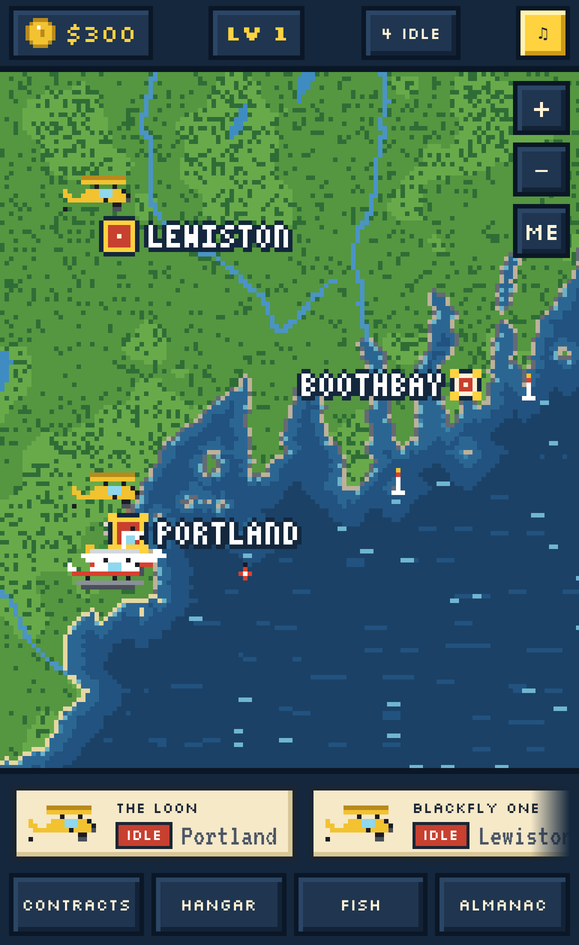
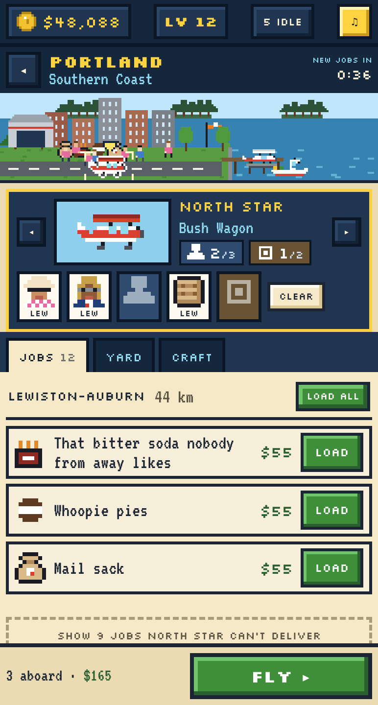
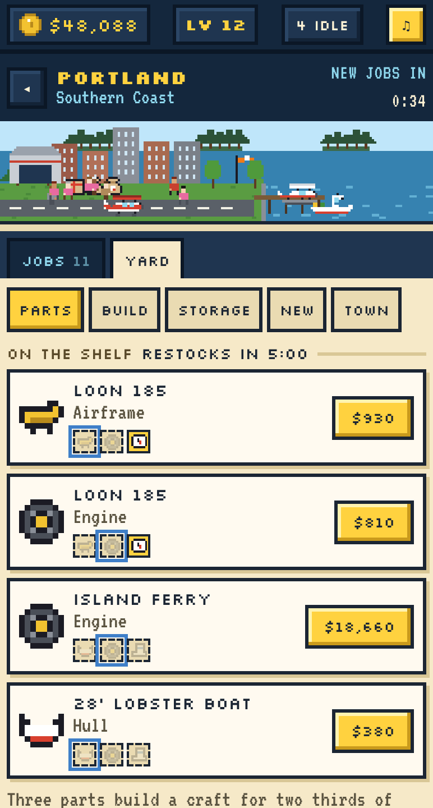
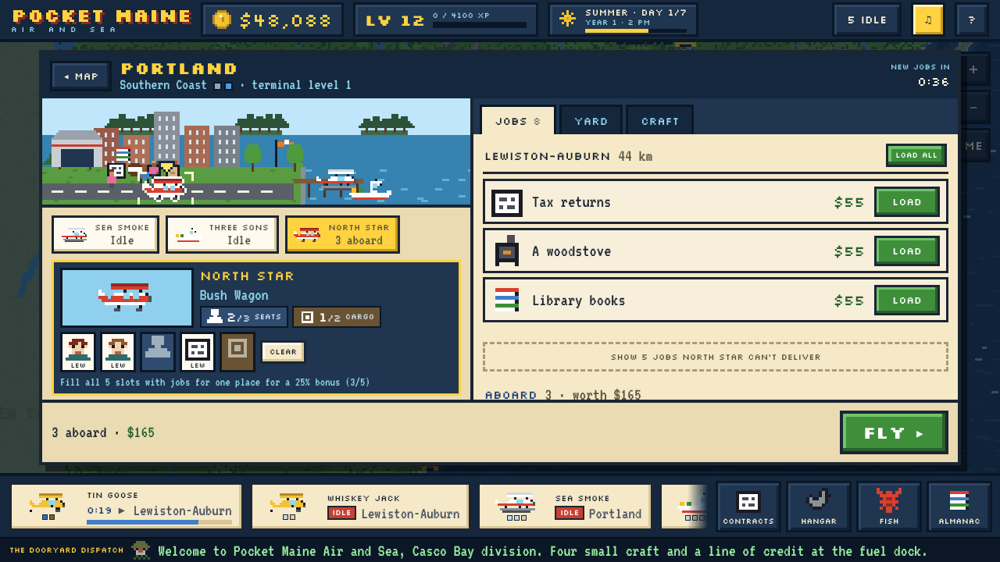

# Pocket Maine - Air and Sea

A cozy pixel-art transport game that starts in Maine and grows to cover New England. You run a small outfit moving people and freight by bush plane, floatplane, ferry and lobster boat, in real time, in the spirit of Pocket Planes.

**Play it:** https://jamesccupps.github.io/PocketMaine/

In Chrome, choose Install or Add to Home screen and it becomes an app: its own icon, full screen, and it opens with no connection once it has been loaded once.

The whole game is one self-contained `index.html`. It runs in any modern browser, on a phone or a desktop, with nothing to install. It saves in the browser, and keeps running while it is closed.

| Map | Port | Hangar |
|---|---|---|
|  |  |  |



## How it plays

1. Open a craft, hit **LOAD** on the jobs you want, then **FLY** (or **CAST OFF** for a boat) and tap where to go on the map.
2. Trips take a few minutes of real time. When a craft shows **ARRIVED**, open it to collect the fare and the XP.
3. Fill a craft with jobs for one destination for a 25% bonus.
4. Spend what you earn on new ports, fleet slots and craft. Planes go from a hangar town, boats from a boatyard town.

A guided tutorial walks a new player through the first run. It can be skipped, and replayed from the Almanac.

### What unlocks as you level

XP comes from fares, catches, contracts, new ports, new craft types and first landings. Each level pays a bonus and a parts crate, and levels 2 to 8 each open something new:

| Level | Unlocks |
|---|---|
| 2 | VIPs and special freight: gold jobs that pay three to four times the fare and bring a tip, XP, a parts crate or a favor at both ports. Some want no stops, a daylight landing or a craft in good repair. Also names and paint |
| 3 | Events, planned a season ahead and listed in the Almanac: festivals, a cruise ship or freighter in port, boat races that move from harbor to harbor, fuel price wars, parts swap meets, storm relief and urgent medical runs. Goods and requests: buy where a thing is made, sell where it is wanted, and bring ports what they ask for |
| 4 | New Hampshire and Vermont open. Wear and overhaul: craft wear with use and are fixed at a yard |
| 5 | Catch and traps: sell the catch where the price is best, set lobster trap strings. Fits: set a craft up for range, speed, thrift or freight, one at a time |
| 6 | Southern New England opens: Boston, the Cape and islands, Rhode Island, Connecticut. Crew: hire one hand per craft, each with one skill |
| 7 | Port works: fuel dock, lobster pound, inn. A rival outfit that claims loads you leave (it can be switched off) |
| 8 | Canada opens: Saint John, Yarmouth, Quebec City, Montreal, with a minute at customs each crossing. Standing runs: a craft shuttles between two ports by itself |

Also in the game:

- **The map.** 54 ports on one hand-drawn map, from Long Island Sound to the St. Lawrence. A boat can follow the coast from Eastport to New Haven.
- **16 craft.** Nine planes and seven boats. The ferry and the freighter take groups and lots of ten or twenty in one tap. The excursion boat takes no jobs at all: pick two to four deep-water harbors and it is paid at every stop. Freighters and excursion boats need a deep-water harbor.
- **Yards.** Hangars and boatyards sell parts (three parts build a craft) and store spare craft. One plane, the Gilded Beav, is never for sale: its parts only come in VIP crates.
- **VIPs with lists.** Three of them keep coming back until they have been everywhere on their list. Finishing a list earns a paint no yard sells.
- **Goods.** Eight of them, each made at some ports and wanted at others. A unit is cheap where it is made and dearer the farther it is carried. Buying pushes the price up, selling pushes it down, and both drift back. Goods fill whatever cargo room the jobs leave.
- **Requests.** A port asks for a good, two requests at a time across the map. Filling one pays 60% over the price and that port's fares pay 3% more from then on, up to 15%. Letting one lapse costs standing there.
- **Connections.** A job no single craft of yours can deliver is marked CONNECTION and pays 35% more. Standing runs take up to four stops, and two runs that share a port hand loads to each other there.
- **A rival.** From level 7 another outfit claims the best load at one of your ports; load it within eighty seconds or it is gone. It stays away from ports where your standing is high.
- **Crew that improve.** Twenty trips with a craft makes a hand seasoned and sixty an old hand, each worth 4% on every fare.
- **The rest.** Contracts, a fish market and 17 fishing grounds, weather that holds craft on the ground, and four seasons that freeze lakes and close grass strips in mud season.

**Holidays** follow the real calendar, eleven of them: New Year, Valentine's Day, St. Patrick's Day, Maple Sunday, Patriots' Day, Memorial Day, Independence Day, Labor Day, Halloween, Thanksgiving and Christmas. The ports are decorated, holiday passengers and freight turn up on the boards and pay 25% more, and carrying the holiday's VIP earns its paint. The Almanac has a switch to turn this off or preview a holiday.

What is done, what is not, and what could come next is in the [roadmap](ROADMAP.md).

## Design choices

- **Real time, no energy.** Trips take real minutes and the game runs while closed, capped at twelve hours. There are no energy timers, no premium currency and nothing to buy.
- **One job, one slot.** Every passenger or parcel takes one seat or one cargo slot, and jobs arrive in same-destination groups, so a bigger craft is still quick to fill. Standing runs take over the repetitive routes late in the game.
- **You choose where to go.** Nothing picks a destination for you. The ports your load is bound for flash on the map.
- **Boats follow the water.** Sea routes are found on a one-kilometre grid of the coast, so a boat goes around a peninsula, not over it.
- **Features arrive one at a time.** A new game is only load, send, collect. Each system is hidden until its level.
- **Original art only.** The map, craft, cargo icons and people are drawn in code. People are generated from a seed.

## Building

The game is built from the files in `src/` into `index.html`:

```
python3 build.py
```

It needs only Python 3. The three fonts in `fonts/` are inlined into the page.

| File | What is in it |
|---|---|
| `src/01_data.js` | Ports, craft, fish, flavor text, tuning numbers |
| `src/02_map.js` | The map: coastline, rasterizer, sea pathfinding |
| `src/03_sim.js` | The rules: jobs, routes, weather, fishing, yards, parts |
| `src/03x_more.js` | Everything that unlocks with levels, and events |
| `src/03y_vip.js` | VIPs and the holiday calendar |
| `src/03z_depth.js` | Goods, requests, the rival, fits, crew ranks |
| `src/04_art.js` | Sprites, icons, generated portraits, the pixel font |
| `src/05_render.js` | Drawing the map and the port scenes |
| `src/06_ui.js` | Screens, the tutorial, input |
| `src/07_main.js` | Saving, the frame loop, startup |
| `manifest.webmanifest`, `sw.js`, `icon-*.png` | What makes the site installable as an app and able to open offline |

## Testing

The rules have no dependency on the page, so they are tested directly in Node:

```
node test/rules.js
```

The rest drive the built page in headless Chrome through Playwright (`pip install playwright`; set `CHROME` to the browser's path if it is not `/usr/bin/google-chrome`). Run them from the repository root:

```
python3 test/audit.py 386x630x3 1280x720x1     # nothing clipped, cropped or off screen, on every screen
python3 test/tutorial.py 386x630x3             # follows the tutorial by tapping only what it highlights
python3 test/levels.py 386x630x3 casco         # levels up and uses each unlock by taps
python3 test/playtest.py 386x630x3 casco       # a long tap-driven session, checking the wording per craft
python3 test/vip.py 386x630x3                  # VIPs, holidays and events by taps, through a save and reload
python3 test/depth.py 386x630x3                # goods, a request, a fit, a three-stop run and the rival switch by taps
python3 test/away.py 386x630x3                 # closes the page mid-trip and reopens it: a real wait, two hours, twenty hours
python3 test/shot.py 1440 900 stress           # 3,000 random steps through every system
```

Sizes are `width x height x pixel ratio`. Widths under 800 are run as a touch phone.

## Credits and licenses

- Code and art: MIT, see [LICENSE](LICENSE).
- Fonts: [Silkscreen](https://github.com/googlefonts/silkscreen) and VT323, both under the SIL Open Font License 1.1. The license texts are in `fonts/`.
- Inspired by Pocket Planes and Pocket Trains by NimbleBit. This is an independent project and is not affiliated with them.
